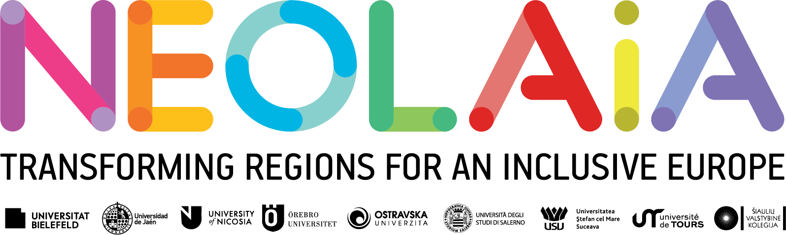

# Bussito Salerno

### Blockchain-Powered Public Transportation Ticketing

**Bussito Salerno** is a blockchain-based ticketing prototype for public transportation in Salerno, Italy. It explores how Ethereum-compatible smart contracts, **ERC-721 digital tickets**, and a **euro-denominated test stablecoin** can support the ticket lifecycle: purchase, boarding validation, conductor verification, and expiration.

## Project Context | NEOLAiA European University Alliance

<p align="center">
  
</p>

Developed during the **NEOLAiA Focus Academy on Blockchain Application Development (26–30 October 2026)**, hosted by the **University of Salerno, Italy**, this project grew out of an international learning experience centered on **European academic collaboration, internationalization, and emerging blockchain technologies**.

Created by a cross-cultural student team, Bussito Salerno connects **Web3 engineering with a tangible urban-mobility use case**. It demonstrates how collaborative academic work can turn ideas about smart contracts and decentralized applications into a working local prototype.

### International Development Team — Group B

- **Leonardo Monaco**
- **Ivan Sukhanov**
- **Mojtaba Hosseini**
- **Bence Kanyok**

**Host institution:** University of Salerno, Italy  
**Program:** NEOLAiA Focus Academy 2026  
**Focus:** Blockchain Application Development · Web3 · International Collaboration

> **Logo setup:** Add your NEOLAiA image to `assets/neolaia.png` in this repository. If it has another name or extension, update the `src` path above. The image is not included in this README file.

---

## How It Works

1. **Buy a ticket:** A passenger purchases a digital bus ticket using a euro-denominated test stablecoin. Each ticket is represented by an **ERC-721 NFT**.
2. **Validate on boarding:** The passenger validates the ticket, recording its status on the local blockchain.
3. **Conductor check:** A conductor enters the ticket ID and passenger wallet address to verify the ticket.
4. **Expiration:** The demo can advance the local chain clock to show a ticket expiring.

This is an **academic prototype running on a local development blockchain**, not an official ticketing service or a live payment system.

## Technology Stack

- **Solidity** — smart contracts
- **Hardhat** — local blockchain, deployment, and testing
- **ERC-721** — NFT-based tickets
- **Euro-denominated test stablecoin** — simulated ticket payments
- **MetaMask** — passenger wallet connection
- **Web frontend** — passenger and conductor views

## Getting Started

### 1. Install

```shell
npm install
cd frontend && npm install && cd ..
```

### 2. Run the tests

```shell
npx hardhat test solidity
```

### 3. Start a local blockchain

In **terminal 1**, keep it running:

```shell
npx hardhat node
```

### 4. Deploy the contracts

In **terminal 2**:

```shell
npx hardhat ignition deploy ignition/modules/BusTicket.ts --network localhost
```

### 5. Run the demo script (optional)

Runs the ticket lifecycle in the terminal: buy, validate, conductor check, expiry, and withdraw.

```shell
npx hardhat run scripts/demo.ts --network localhost
```

### 6. Start the frontend

In **terminal 3**, keep it running:

```shell
cd frontend
npm run dev
```

Open `http://localhost:5173`.

### 7. Set up MetaMask (rider view)

1. Import a **Hardhat test account** into MetaMask. Account #1 private key:

   ```text
   0x59c6995e998f97a5a0044966f0945389dc9e86dae88c7a8412f4603b6b78690d
   ```

   **Warning:** This is a publicly known local development key. **Never use it on a real network or send real funds to it.**

2. Click **Connect MetaMask** in the app. It automatically switches to the local network (chain ID `31337`).
3. Click **Get 10 test EUR**, then **Buy ticket**, then **Validate**.

The **Conductor** tab needs no wallet: enter a ticket ID and the rider's address.

Use **Skip 91 min** in the footer to move the local blockchain clock forward and demonstrate ticket expiration.

## Restarting

`npx hardhat node` starts from an empty chain each time. After restarting it, redeploy:

```shell
rm -rf ignition/deployments/chain-31337
npx hardhat ignition deploy ignition/modules/BusTicket.ts --network localhost
```

If MetaMask shows nonce errors, go to **Settings → Advanced → Clear activity tab data**.

---

## Project Vision

Bussito Salerno explores how blockchain technology could support verifiable digital ticketing in urban transportation. As a project developed in an international academic setting, it brings together **practical smart-contract development, collaborative problem-solving, and European exchange**.

**Developed by Group B | NEOLAiA Focus Academy 2026**  
*University of Salerno — Blockchain Application Development*
